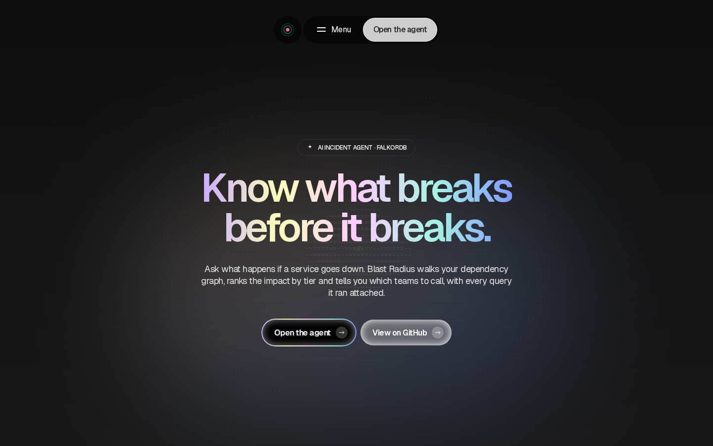
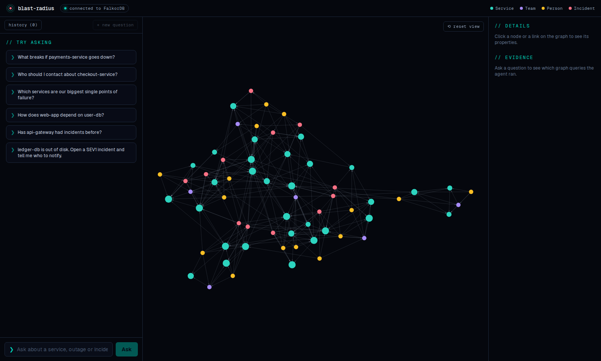
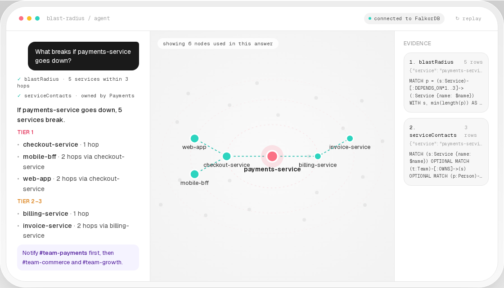
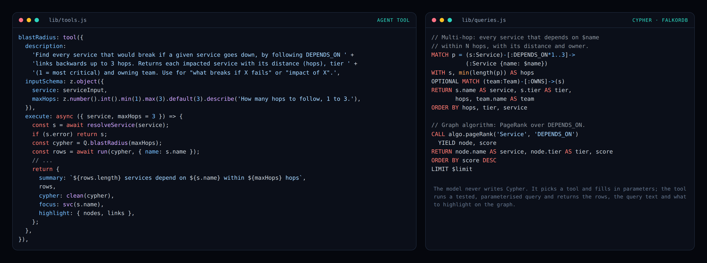
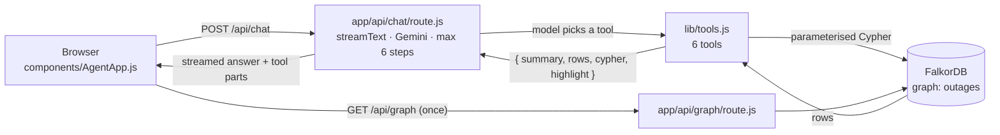
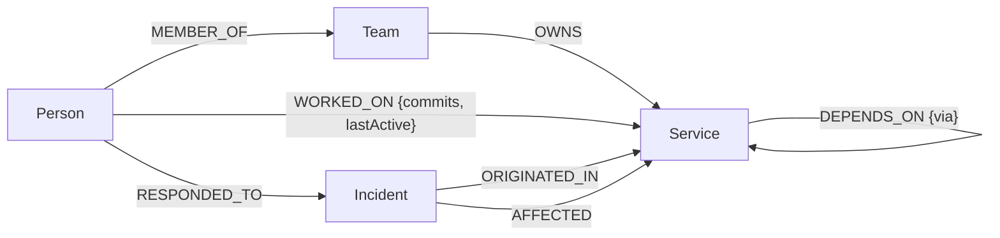

# Blast Radius

**Know what breaks before it breaks.** Blast Radius is an AI incident agent that uses a [FalkorDB](https://www.falkordb.com/) graph of services, teams, engineers and past outages as its context layer. Ask it what happens if a service goes down: it walks the dependency graph, ranks the impact by tier, tells you which teams to call, and shows every graph query it ran to get there.

Built for **Graph Hacks: Context for AI Agents** (WeMakeDevs × FalkorDB, Oct 2026), **Track 01: Agents That Act on Connected Data**.

- **Live demo:** _add your Vercel URL here_
- **Demo video:** _add your video link here_



---

## Contents

- [Why a graph](#why-a-graph)
- [What it does](#what-it-does)
- [Screenshots](#screenshots)
- [How it works](#how-it-works)
- [The graph model](#the-graph-model)
- [Agent tools](#agent-tools)
- [Explainability and safety](#explainability-and-safety)
- [Tech stack](#tech-stack)
- [Getting started](#getting-started)
- [Environment variables](#environment-variables)
- [Deploying](#deploying)
- [Project structure](#project-structure)
- [What's next](#whats-next)

---

## Why a graph

In the first minutes of an outage, the questions are all about relationships:

- *What depends on this service, directly or three levels out?*
- *Which of those are tier 1?*
- *Who owns them, who has actually worked on the code, and where do I ping them?*
- *Has this failed before, and where did that incident start?*

Dashboards and wikis store these facts in separate places. A graph stores the connections themselves, so "everything that depends on `payments-service` within 3 hops, with its owner" is a single Cypher query. Built-in algorithms like PageRank and shortest path answer questions that would take many lookups anywhere else.

In Blast Radius the graph is not a side lookup. **Every fact in an answer comes from a FalkorDB query**, and the agent decides what to ask next based on what the graph returned.

## What it does

Ask a question in plain English. The agent picks the right graph tools, chains them if needed, and answers with the path it followed:

| You ask | The agent |
|---|---|
| *What breaks if payments-service goes down?* | Follows `DEPENDS_ON` links backwards up to 3 hops, lists impacted services by tier and distance, names the owning teams and their Slack channels |
| *Who should I contact about checkout-service?* | Returns the owning team and the engineers who worked on it, ordered by commits |
| *Which services are our biggest single points of failure?* | Runs **PageRank** over the dependency graph |
| *How does web-app depend on user-db?* | Finds the **shortest dependency path** between the two |
| *Has api-gateway had incidents before?* | Lists past incidents, their severity, root cause and the service each one started in |
| *ledger-db is out of disk. Open a SEV1 incident and tell me who to notify.* | Runs a blast radius first, then **writes** a new incident into the graph linked to every affected service |

While it answers, the graph canvas fades out everything except the nodes and links used in the answer and zooms to them. An evidence panel lists each tool call, its inputs and the exact Cypher it ran.

## Screenshots

**The agent:** chat on the left, the live FalkorDB graph in the middle (services, teams, people and incidents), details and evidence on the right.



**An answer, explained:** "What breaks if payments-service goes down?" The agent calls `blastRadius` and `serviceContacts`, groups the 5 impacted services by tier, says how many hops away each one is, and lists the Slack channels to notify. The graph shows only the nodes used in the answer, and the evidence panel shows the Cypher behind it. (This is the landing page's replay of the agent's answer on the demo graph.)



**Under the hood:** the model never writes Cypher. Each tool wraps a tested, parameterised query and returns the rows, the query text and what to highlight on the graph.



## How it works



1. The chat page sends the question to `/api/chat`.
2. The route calls Gemini through the Vercel AI SDK (`streamText`) with a system prompt that describes the graph schema, plus the tool definitions.
3. The model chooses a tool and fills in its inputs, for example `blastRadius({ service: "payments" })`. The tool resolves the name to `payments-service`, runs its Cypher against FalkorDB and returns a structured result.
4. The model reads the result and either calls more tools (up to 6 steps in total) or writes the final answer. Everything streams back to the browser.
5. The UI collects the `highlight` from every tool result and lights up exactly those nodes and links on the canvas.

## The graph model



| Node | Key properties |
|---|---|
| `Service` | `name`, `tier` (1 = most critical), `type`, `tech`, `description` |
| `Team` | `name`, `slack`, `focus` |
| `Person` | `id`, `name`, `role` |
| `Incident` | `id`, `title`, `severity`, `startedAt`, `durationMinutes`, `rootCause` |

The demo data in [`graph-data.json`](graph-data.json) is a fictional company with **30 services, 6 teams, 15 engineers, 12 past incidents and 55 dependencies**: 63 nodes and 262 relationships once seeded.

## Agent tools

All tools live in [`lib/tools.js`](lib/tools.js). Their Cypher lives in [`lib/queries.js`](lib/queries.js).

| Tool | Graph technique | What it returns |
|---|---|---|
| `blastRadius` | Variable-length traversal `-[:DEPENDS_ON*1..3]->` | Every service that would break, with hops, tier and owning team |
| `serviceContacts` | `OWNS` + `WORKED_ON`, ordered by commits | Owning team, Slack channel, engineers who know the code |
| `incidentHistory` | `AFFECTED` + `ORIGINATED_IN` | Past incidents, newest first, with root cause and origin service |
| `dependencyPath` | `shortestPath()` | The shortest chain of dependencies from A to B |
| `criticalServices` | `algo.pageRank('Service', 'DEPENDS_ON')` | The services the most (important) services rely on |
| `createIncident` | `CREATE` with `ORIGINATED_IN` / `AFFECTED` links | **Action:** a new open incident in the graph, plus who to notify |

Service names are resolved forgivingly: `payments` becomes `payments-service`. If a name is ambiguous, the tool returns suggestions and the agent asks you which one you meant instead of guessing.

## Explainability and safety

**Every answer shows its work**
- Each tool returns `{ summary, rows, cypher, highlight }`.
- The evidence panel lists every tool the agent ran, its inputs, the row count and the exact Cypher.
- The canvas highlights only the nodes and links used, and you can click any of them to see their properties.
- The system prompt makes the agent explain the path it followed: which links, and how many hops away a service is.

**Safe by default**
- **The model never writes Cypher.** It can only choose one of six tested queries and fill in parameters. Values are always passed as query parameters, never pasted into the query string. The one exception, the hop limit, is a validated integer from 1 to 3.
- **Reads are read-only at the database level:** lookups use FalkorDB's `roQuery`.
- **One write action**, `createIncident`, which you can switch off with `ALLOW_WRITES=false`.
- **Bounded cost:** at most 6 model steps and 1,200 output tokens per question.
- **Clear quota message:** if the Gemini free-tier quota runs out, the chat shows a "Demo limit reached" notice instead of a broken chat.

Past questions are saved in your browser (localStorage, up to 30) and can be reopened with their graph highlight and evidence. Each new question is answered on its own, without earlier chat context.

## Tech stack

| Layer | Technology |
|---|---|
| Graph database | [FalkorDB](https://www.falkordb.com/) via the [`falkordb`](https://www.npmjs.com/package/falkordb) Node.js client |
| Agent | [Vercel AI SDK](https://ai-sdk.dev/) (`streamText`, tools, `useChat`) with Google Gemini |
| Tool schemas | [Zod](https://zod.dev/) |
| App | [Next.js](https://nextjs.org/) (App Router), React |
| Graph canvas | [react-force-graph-2d](https://github.com/vasturiano/react-force-graph) |
| Styling | Tailwind CSS v4 |

## Getting started

### Prerequisites

- Node.js 20 or newer
- Docker, to run FalkorDB locally
- A Google Gemini API key ([get one in Google AI Studio](https://aistudio.google.com/apikey)); the free tier is enough

### 1. Clone and install

```bash
git clone https://github.com/BUBAAcodes/Blast-Radius-fkdb.git
cd Blast-Radius-fkdb
npm install
```

### 2. Start FalkorDB

```bash
docker run -p 6379:6379 -p 3000:3000 -it --rm falkordb/falkordb
```

Port `6379` is the database. Port `3000` is the optional FalkorDB Browser UI. If you publish it, Next.js will pick port `3001` instead.

### 3. Add your environment variables

Create a file called `.env.local` in the project root:

```bash
GOOGLE_GENERATIVE_AI_API_KEY=your-gemini-api-key
```

That is all you need locally. The FalkorDB settings default to `localhost:6379`. See [Environment variables](#environment-variables) for the rest.

### 4. Load the demo graph

```bash
npm run seed -- --reset
```

It should print `63 nodes, 262 relationships`. The seed script uses `MERGE`, so it is safe to re-run. `--reset` deletes the graph first for a clean load.

### 5. Run the app

```bash
npm run dev
```

Open [http://localhost:3000](http://localhost:3000) for the landing page, or go straight to [`/agent`](http://localhost:3000/agent) and try one of the example questions.

### Testing the tools without the model

```bash
node scripts/test-tools.mjs
```

This runs every read tool directly against FalkorDB and prints a summary of each result, without using any Gemini quota.

## Environment variables

| Variable | Default | Purpose |
|---|---|---|
| `GOOGLE_GENERATIVE_AI_API_KEY` | none (required) | Gemini API key |
| `GEMINI_MODEL` | `gemini-3.8-flash` | Which Gemini model the agent uses |
| `FALKORDB_HOST` | `localhost` | FalkorDB host |
| `FALKORDB_PORT` | `6379` | FalkorDB port |
| `FALKORDB_TLS` | none | Set to `true` for encrypted connections, e.g. FalkorDB Cloud |
| `FALKORDB_USERNAME` | none | FalkorDB username, if your instance needs one |
| `FALKORDB_PASSWORD` | none | FalkorDB password, if your instance needs one |
| `FALKORDB_GRAPH` | `outages` | Name of the graph to use |
| `ALLOW_WRITES` | none (writes allowed) | Set to `false` to turn off `createIncident` |
| `NEXT_PUBLIC_DEMO_VIDEO_URL` | none | Link shown in the "Demo limit reached" notice |

The app and the seed script read the same `FALKORDB_*` variables, so they always target the same graph.

## Deploying

The app deploys to [Vercel](https://vercel.com/) with a [FalkorDB Cloud](https://www.falkordb.com/) instance:

1. Create a FalkorDB Cloud instance and note its host, port, username and password.
2. Seed it once from your machine. Put the Cloud values in `.env.local`, then run:
   ```bash
   node --env-file=.env.local script.mjs --reset
   ```
   (`npm run seed` alone does not read `.env.local`, so use this form for any non-local database.)
3. Import the repo into Vercel and add the environment variables from the table above.
4. Optionally set `ALLOW_WRITES=false` so visitors can't create incidents, and `NEXT_PUBLIC_DEMO_VIDEO_URL` to your demo video.

## Project structure

```
app/
  page.js               Landing page (numbers and examples computed from the seed data)
  agent/page.js         The agent UI
  api/chat/route.js     The agent: system prompt, model, tools, step limit
  api/graph/route.js    Returns every node and link for the canvas
components/
  AgentApp.js           Chat, example questions, history, collects tool highlights
  GraphView.js          Force-directed canvas; fades everything except the answer
  DetailsPanel.js       Properties of the clicked node or link
  landing/              Landing page sections
lib/
  falkor.js             Shared FalkorDB connection: getGraph() and run()
  queries.js            Every Cypher query the app uses
  tools.js              The six agent tools
  chat-history.js       Past questions in localStorage
  landing-data.js       Landing page numbers, computed from graph-data.json
scripts/
  test-tools.mjs        Runs the tools directly against FalkorDB
script.mjs              Seed script: loads graph-data.json into FalkorDB
graph-data.json         Demo data: teams, services, people, incidents, dependencies
```

## What's next

- **Graph-backed memory:** store past questions and the services they touched in FalkorDB, so the agent can recall earlier investigations across sessions.
- **MCP server:** expose the same six tools over the Model Context Protocol, so Claude Desktop, Cursor or any MCP client can use Blast Radius.
- **Runbooks and postmortems in the graph:** link documents to services and return answers with sources.
- **Live data:** import service dependencies from tracing (e.g. OpenTelemetry) and incidents from an incident tool, instead of a static seed file.
